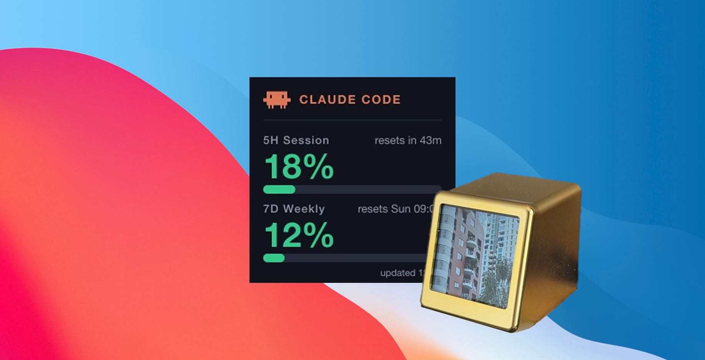

# Mini Display AI Usage (Claude)



แสดง **โควตาการใช้งาน Claude Code** (หน้าต่าง 5 ชั่วโมง และ 7 วัน) บนจอ **Mini Display (Smart Clock Pro Ultra / GeekMagic Ultra)** ขนาด 240×240
โปรแกรมนี้จะอ่านเปอร์เซ็นต์ที่ใช้ไปจากบัญชี Claude Code ของคุณ แล้วทำเป็นรูปเล็ก ๆ ส่งไปแสดงบนจอที่ต่อ Wi-Fi บ้านหรือออฟฟิศเดียวกัน และอัปเดตให้เองทุกไม่กี่นาที
ตั้งค่าง่าย แค่ล็อกอิน Claude Code ไว้ในเครื่องที่รันสคริปต์ (**ไม่ต้องใส่ API key ไม่ต้องสมัครบริการเสริม**)

โปรเจกต์เพื่อนบ้าน: [mini-display-calendar](https://github.com/Datayolk/mini-display-calendar) (แสดงประชุมถัดไปจาก Google Calendar) และ [mini-display-receiver-photo](https://github.com/Datayolk/mini-display-receiver-photo) (แอป Desktop ที่ส่งรูปจากลิงก์ขึ้นจอ)

```
Claude Code login ──► เรียก usage API ──► สร้างการ์ด 240×240 ──► อัปโหลดขึ้นจอ (LAN)
                                                   └──► usage.png (ไว้เปิดดูว่าจอแสดงอะไรอยู่)
```

## การ์ดที่แสดง

| ส่วน | แสดงอะไร |
| --- | --- |
| **5H Session** | % ที่ใช้ไปในหน้าต่าง 5 ชั่วโมง แถบความคืบหน้า และเวลารีเซ็ต ("resets in 3h 46m") |
| **7D Weekly** | % ที่ใช้ไปในหน้าต่าง 7 วัน แถบความคืบหน้า และวัน/เวลารีเซ็ต ("resets Sun 09:00") |
| **updated HH:MM** | เวลาที่อัปเดตการ์ดล่าสุด |

สีของตัวเลขและแถบเปลี่ยนตามระดับการใช้งาน: **เขียว** (ต่ำกว่า 70%) · **ส้ม** (70% ขึ้นไป) · **แดง** (90% ขึ้นไป)

> ⚠️ ข้อมูลมาจาก endpoint `/api/oauth/usage` ของ Anthropic ซึ่ง**ไม่มีเอกสารทางการ** อาจเปลี่ยนหรือหยุดทำงานได้โดยไม่แจ้งล่วงหน้า

---

## 📦 อุปกรณ์ Mini Display

ต้องมีจอ Mini Display อย่างใดอย่างหนึ่งต่อไปนี้ ต่อ Wi-Fi (2.4 GHz หรือ Personal hotspot) อยู่ในวง LAN เดียวกับเครื่องที่รันแอปนี้:

### GeekMagic Ultra
ราคาประมาณ 500 บาท อ่านวิธีการเชื่อมต่อ[ที่นี่](https://github.com/GeekMagicClock/smalltv-ultra/blob/main/Latest%20GeekMagic%20SmallTV-Ultra%20User%20Manual%20V9.0.30.pdf)

[สั่งซื้อ GeekMagic Ultra](https://s.shopee.co.th/5VUGnx0AQ3)

### Smart Clock Pro Ultra
ราคาประมาณ 350 บาท อ่านวิธีการเชื่อมต่อ [ที่นี่](https://bit.ly/SMWCP)

[สั่งซื้อ Smart Clock Pro Ultra](https://s.shopee.co.th/AUsq9bAkQS)

## 📋 สิ่งที่ต้องเตรียม

- จอ Mini Display ต่อ Wi-Fi 2.4 GHz (หรือใช้ Personal Hotspot ก็ได้) วง LAN เดียวกับเครื่องที่รันสคริปต์ และรู้ IP ของจอ
- **Node.js 22 ขึ้นไป** (ดู [`.nvmrc`](.nvmrc))
- ติดตั้ง [Claude Code](https://claude.com/claude-code) และล็อกอินแล้ว (สมัครแพ็กเกจ Pro/Max) บนเครื่องที่รันสคริปต์

## 🔒 ความปลอดภัยของ Token

สคริปต์อ่าน OAuth token ของ Claude Code ตอนรันเท่านั้น จาก **macOS Keychain** (`Claude Code-credentials`) หรือถ้าไม่มีให้อ่านจาก `~/.claude/.credentials.json`
Token **ไม่ถูกพิมพ์ ไม่ถูกบันทึก ไม่ถูกเขียนลงไฟล์ใด ๆ** และส่งไปที่ `api.anthropic.com` เท่านั้น ไม่ต้องคัดลอก token มาใส่ใน `.env`
ครั้งแรกที่รันบน macOS อาจมีหน้าต่างถามสิทธิ์เข้าถึง Keychain ให้กด Allow

## 🤖 ไม่อยากใช้ Terminal? สั่ง AI ทำให้แทน

ถ้าไม่ถนัดพิมพ์คำสั่งเอง ใช้ AI ช่วยทำได้ เช่น [Claude Code](https://claude.com/claude-code) หรือ Codex เปิดโฟลเดอร์โปรเจกต์นี้ในโปรแกรมนั้น แล้วคัดลอก Prompt ด้านล่างไปวางทีละข้อ
AI จะอ่านคู่มือในไฟล์ [AGENTS.md](AGENTS.md) และรันคำสั่งให้เอง พร้อมรายงานผลเป็นภาษาที่เข้าใจง่าย

### Prompt 1: ติดตั้ง (Install)

```
ช่วยติดตั้งโปรเจกต์นี้ให้หน่อย ฉันไม่ถนัดใช้ Terminal
1. เช็กว่าเครื่องมี Node.js เวอร์ชัน 22 ขึ้นไปหรือยัง ถ้ายังไม่มีหรือเก่าเกินไป ให้บอกวิธีติดตั้งที่เหมาะกับเครื่องฉัน
2. รัน npm install
3. ถ้ามีขั้นไหนผิดพลาด ให้หยุดแล้วอธิบายเป็นภาษาง่าย ๆ ว่าเกิดอะไรขึ้นและฉันต้องทำอะไรต่อ
เมื่อเสร็จให้สรุปว่าอะไรผ่านแล้วบ้าง
```

### Prompt 2: ตั้งค่า `.env` (Setup env)

```
ช่วยตั้งค่าไฟล์ .env ให้หน่อย
- ถ้ายังไม่มี .env ให้คัดลอกจาก .env.example
- ถามฉันทีละข้อ (ห้ามเดาเอง): IP ของจอ Mini Display, รุ่นจอ (GeekMagic Ultra หรือ Smart Clock Pro Ultra) เพื่อกำหนด DEVICE_URL กับ UPLOAD_DIR ให้ถูก, และจะให้อัปเดตจอทุกกี่นาที (INTERVAL_MINUTES)
- ห้ามอ่านหรือแสดง OAuth token ของ Claude Code
- สรุปค่าที่ตั้งให้ดูตอนท้าย
```

### Prompt 3: รันทดสอบตามขั้นตอน (Test step by step)

```
ช่วยทดสอบโปรเจกต์นี้ทีละขั้น หยุดและรายงานทันทีถ้าขั้นไหนไม่ผ่าน ก่อนรันคำสั่งที่เปลี่ยนภาพบนจอจริง ให้บอกฉันก่อนเสมอ
ขั้น 1: รัน npm run upload เพื่อส่งรูปตัวอย่างขึ้นจอ ต้องขึ้นว่า Device responded 200
ขั้น 2: รัน npm run usage -- --mock --five 95 --seven 40 (ใช้ข้อมูลจำลอง ยังไม่ส่งขึ้นจอ) แล้วเปิดดู usage.png บอกฉันว่าเห็นอะไร
ขั้น 3: รัน npm run usage (ใช้ข้อมูลจริง) เปิดดู usage.png เช็กว่าตัวเลขตรงกับที่ Claude Code แสดง จากนั้นรัน npm run usage:upload
ขั้น 4: ถามฉันก่อนว่าจะให้รัน npm run watch เพื่ออัปเดตจออัตโนมัติหรือไม่ และบอกวิธีหยุดให้ด้วย
ตอนท้ายสรุปว่าอะไรผ่าน อะไรที่ยืนยันไม่ได้ (เช่น หาจอในเครือข่ายไม่เจอ)
```

---

## 🚀 เริ่มใช้งาน

### 1. ติดตั้ง Node.js

- **macOS (ดาวน์โหลดจากเว็บ ไม่ต้องใช้คำสั่ง):** เข้า https://nodejs.org กดปุ่มดาวน์โหลดเวอร์ชัน **LTS** (ต้องเป็น 22 ขึ้นไป) จะได้ไฟล์ `.pkg` เปิดไฟล์แล้วกด Continue ไปเรื่อย ๆ จนติดตั้งเสร็จ
- **macOS (ใช้คำสั่ง):** `brew install node@22` หรือใช้ [nvm](https://github.com/nvm-sh/nvm): `nvm install 22`
- **Windows:** ดาวน์โหลด LTS จาก https://nodejs.org

ตรวจสอบ: `node -v` ต้องขึ้น `v22.x` ขึ้นไป

### 2. ล็อกอิน Claude Code

ติดตั้ง [Claude Code](https://claude.com/claude-code) แล้วรัน `claude` ล็อกอินให้เรียบร้อยหนึ่งครั้ง

### 3. เอาโปรเจกต์มาไว้ในเครื่อง

โหลดเป็น **ZIP** แล้วแตกไฟล์ก็ได้ ไม่จำเป็นต้องใช้ git จากนั้น:

```bash
cd mini-display-ai-usage
npm install
```

### 4. ตั้งค่า `.env`

```bash
cp .env.example .env
```

แก้ค่าใน `.env`:

| ตัวแปร | ความหมาย | ค่าเริ่มต้น |
| --- | --- | --- |
| `DEVICE_URL` | URL อัปโหลดของจอ แทน `192.168.xx.xx` ด้วย IP จอ | `http://10.255.221.161/photo/upload` |
| `UPLOAD_DIR` | โฟลเดอร์บนจอ | `/photo/` |
| `IMAGE_PATH` | รูปที่ใช้กับ `npm run upload` | `example.png` |
| `INTERVAL_MINUTES` | อัปเดตจอทุกกี่นาที (ใส่ทศนิยมได้ เช่น `0.5`) | `5` |
| `PREVIEW_PATH` | ไฟล์ PNG ของภาพที่ส่งขึ้นจอ เขียนทับทุกรอบ ค่าว่าง = ปิด | `usage.png` |

> ตัวแปรที่ตั้งใน shell จะมีความสำคัญกว่าค่าใน `.env`

#### ⚙️ ค่า `DEVICE_URL` / `UPLOAD_DIR` ตามรุ่นจอ

ใส่ค่าใน `.env` ตามรุ่นจอที่ใช้ แทนที่ `192.168.xx.xx` ด้วย IP จริงของจอในเครือข่ายคุณ:

| Brand                 | `DEVICE_URL`                        | `UPLOAD_DIR` |
| --------------------- | ----------------------------------- | ------------ |
| GEEK MAGIC ULTRA      | `http://192.168.xx.xx/doUpload`     | `/image/`    |
| Smart Clock Pro Ultra | `http://192.168.xx.xx/photo/upload` | `/photo/`    |

### 5. ทดสอบทีละขั้น

**5.1 ส่งรูปตัวอย่างขึ้นจอ** (เช็กว่าต่อจอได้)

```bash
npm run upload            # ส่ง example.png
node upload.mjs รูปอื่น.png
```
ถ้าขึ้น `Device responded 200 — done` แปลว่าจอรับรูปแล้ว

**5.2 ข้อมูลจำลอง (Mock)** ยังไม่ต้องเรียก API

```bash
npm run usage -- --mock                       # วาดการ์ดจากข้อมูลจำลอง เขียน usage.png (ไม่ส่งขึ้นจอ)
npm run usage -- --mock --five 95 --seven 40 # บังคับเปอร์เซ็นต์ ไว้ดูสีเหลือง/แดง
```
เปิด `usage.png` ดูได้เลยว่าหน้าตาเป็นอย่างไร

**5.3 ข้อมูลจริงจาก Claude Code**

```bash
npm run usage             # ดึงข้อมูลจริง เขียน usage.png (ไม่ส่งขึ้นจอ)
npm run usage:upload      # ดึงข้อมูลจริงแล้วส่งขึ้นจอ
```
เช็กว่าตัวเลขใน `usage.png` ตรงกับที่ Claude Code แสดง (พิมพ์ `/usage` ใน Claude Code) แล้วค่อยส่งขึ้นจอ

### 6. รันอัตโนมัติทุก N นาที

```bash
npm run watch
```
ส่งขึ้นจอทันที 1 ครั้ง แล้วทำซ้ำทุก `INTERVAL_MINUTES` นาที ถ้าเน็ตหรือจอมีปัญหาจะแจ้ง error แล้วลองใหม่รอบถัดไป กด `Ctrl+C` เพื่อหยุด
ตัวอย่าง log:

```
Updating every 5 min. Ctrl+C to stop.
[16:04:12] uploaded 12.3 KB (api), device 200
```

ปิด Terminal แล้วสคริปต์จะหยุด ถ้าอยากให้รันค้างเบื้องหลัง:

- **macOS / Linux:** `nohup npm run watch > watch.log 2>&1 &`  (หยุดด้วย `pkill -f watch.mjs`)
- **pm2:** `npx pm2 start watch.mjs --name mini-display-ai-usage` แล้ว `npx pm2 save`
- **macOS launchd / Windows Task Scheduler:** ตั้งให้รัน `node watch.mjs` ตอนเปิดเครื่อง โดยกำหนด working directory เป็นโฟลเดอร์โปรเจกต์

แก้ `.env` แล้วต้อง restart สคริปต์ถึงจะมีผล

---

## 🧰 คำสั่งทั้งหมด

| คำสั่ง | ทำอะไร |
| --- | --- |
| `npm run upload` | ย่อรูปเป็น 240×240 JPEG แล้วส่งขึ้นจอ |
| `npm run usage` | วาดการ์ดโควตาเป็น `usage.png` (ไม่ส่งขึ้นจอ) |
| `npm run usage:upload` | วาดการ์ดแล้วส่งขึ้นจอ |
| `npm run watch` | วาด + ส่งขึ้นจอซ้ำทุก `INTERVAL_MINUTES` นาที |

ตัวเลือกของ `node usage.mjs`: `--mock` · `--five <N>` · `--seven <N>` (ใช้คู่กับ `--mock`) · `--preview <ไฟล์.png>` · `--upload`
ตัวเลือกของ `node watch.mjs`: `--mock`

## 🗂️ โครงสร้างโปรเจกต์

```
usage.mjs  upload.mjs  watch.mjs     คำสั่งที่รัน (CLI)
src/
  config.mjs          อ่าน .env ที่เดียว ตั้งค่าเริ่มต้น + ตรวจค่า
  app.mjs             buildCard / pushCard / savePreview
  sources/            token.mjs (อ่าน token), usage.mjs (เรียก API), mock.mjs
  domain/             usage-level.mjs แบ่งระดับ ok / warn / high
  render/             theme.mjs (สี/ฟอนต์), card-model.mjs, card.mjs, ...
  device.mjs          อัปโหลดขึ้นจอ (raw TCP)
```

### ปรับแต่งเอง

- **เปลี่ยนสี/ฟอนต์/ขนาดตัวอักษร/เกณฑ์เตือน (70% / 90%):** แก้ [`src/render/theme.mjs`](src/render/theme.mjs)
- **เปลี่ยนมาสคอต:** แทนที่ไฟล์ `claude-mascot.png`
- **ถ้า API เปลี่ยนรูปแบบ:** แก้ที่ [`src/sources/usage.mjs`](src/sources/usage.mjs) ที่เดียว

## ❓ ปัญหาที่พบบ่อย

| อาการ | วิธีแก้ |
| --- | --- |
| `Device upload timed out after 10 s` / `ETIMEDOUT` | IP ใน `DEVICE_URL` ผิด หรือจอกับเครื่องอยู่คนละ Wi-Fi ลองเปิด `http://<IP จอ>/` ในเบราว์เซอร์ |
| `Device responded 4xx/5xx` | เช็ก `DEVICE_URL` (ลงท้าย `/photo/upload`) และ `UPLOAD_DIR` (`/photo/`) ให้ตรงกับรุ่นจอ |
| `Claude Code login not found. Run \`claude\` and log in.` | ยังไม่ได้ล็อกอิน Claude Code บนเครื่องนี้ รัน `claude` แล้วล็อกอิน |
| `Claude token expired (401)` | Token หมดอายุ เปิด `claude` ใช้งานสักครั้งให้มันรีเฟรชล็อกอิน แล้วรันใหม่ |
| `Usage API responded 4xx/5xx` | endpoint ไม่มีเอกสารทางการ อาจเปลี่ยนหรือถูกจำกัดการเรียก ลองใหม่ภายหลัง |
| `Usage API: no five_hour.utilization` | รูปแบบ response เปลี่ยน แก้ parser ใน `src/sources/usage.mjs` |
| ขึ้น `Using mock usage` | รันด้วย `--mock` อยู่ ตัดออกเพื่อใช้ข้อมูลจริง |
| เวลารีเซ็ตไม่ตรง | การ์ดใช้เขตเวลาของเครื่องที่รันสคริปต์ |
| `Bad INTERVAL_MINUTES` | ใส่เป็นตัวเลขมากกว่า 0 |
| ฟอนต์ในการ์ดดูต่างจากตัวอย่าง | SVG ใช้ฟอนต์ที่มีในเครื่อง (Helvetica/Arial) บน Linux/Windows อาจต่างเล็กน้อย |
